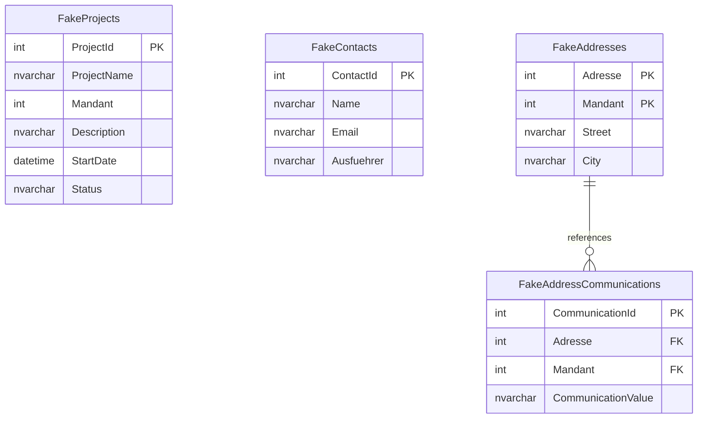

# Fictional Database Schema

This directory contains the SQL script (`01_fictional_schema.sql`) to set up the fictional database schema used in the integration and unit tests for the `SqlToAi` project.

For a local manual demo or SQL integration test setup, use the separate
[DemoDB example profile](../src/SqlToAi/demo-profile.json). It grants
`ReadWrite` access to `DemoDB` and contains fictional throwaway credentials for
the configured local SQL Server instance. The production host never loads this
file automatically. The main [settings template](../src/SqlToAi/appsettings.json)
contains no credentials or database grants.

The automated SQL integration fixture explicitly loads this demo profile from
the test output as `appsettings.integration.json`. It does not inspect
`%LOCALAPPDATA%\SqlToAi` or use the main template. The local SQL Server must
provide the configured `DemoDB` database and fictional schema.

## Schema Overview

The fictional schema replaces real ERP tables with generic counterparts to avoid dependencies on actual production ERP systems.

### Objects

1. **`dbo.FakeProjects`**
   - **Purpose:** Contains project meta-information.
   - **Key Fields:** `ProjectId` (PK), `ProjectName`, `Mandant` (Client/Tenant), `Status`.

2. **`dbo.vewFakeProjectList` (View)**
   - **Purpose:** Exposes project overview columns.

3. **`dbo.FakeContacts`**
   - **Purpose:** Used for anonymization checks (like checking PII scrambling).
   - **Key Fields:** `Name`, `Email`, `Ausfuehrer` (Executor).

4. **`dbo.FakeAddresses`**
   - **Purpose:** Part of the composite key constraint test.
   - **Key Fields:** `Adresse` (Address ID), `Mandant` (Client/Tenant) — Composite Primary Key.

5. **`dbo.FakeAddressCommunications`**
   - **Purpose:** Part of the composite key constraint test.
   - **Key Fields:** `CommunicationId` (PK), `Adresse`, `Mandant` (Composite Foreign Key referencing `dbo.FakeAddresses`).

6. **`dbo.spFakeSysTan` (Stored Procedure)**
   - **Purpose:** Used for validating routine parameter inspection.
   - **Parameters:** `@TanType` (input), `@NextValue` (output).

